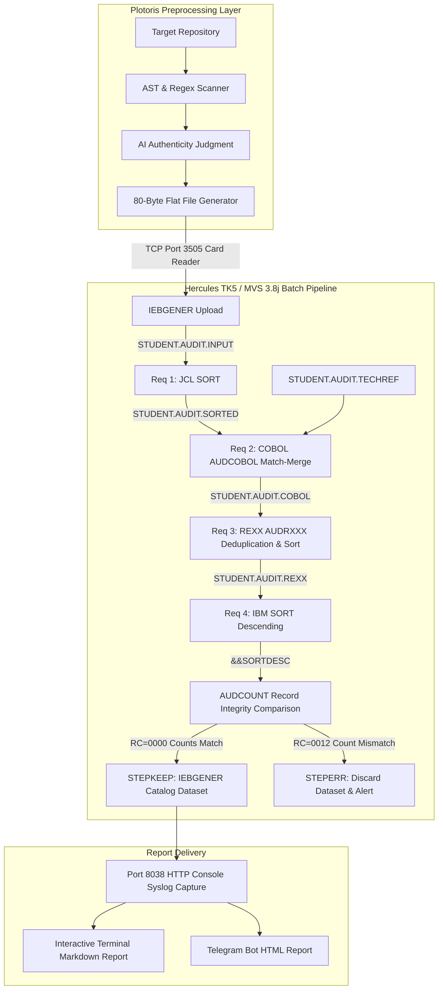

# Mainframe Codebase Auditor — Complete Project & Evaluation Manual

> **Course Project**: Enterprise Batch Processing & Systems Architecture  
> **Target Environment**: IBM z/OS / MVS 3.8j on Hercules TK5 + Plotoris Agentic CLI (Bun/TypeScript)  
> **Date**: October 2026  
> **Status**: ✅ Fully Implemented, Tested, and Verified

---

## 1. Executive Summary & Purpose

The **Mainframe Codebase Auditor** is an enterprise batch-processing pipeline designed to inspect software repositories (e.g., student submissions) and verify the authenticity of claimed technologies.

Modern students often include popular libraries in `package.json` or add unused import statements to give the appearance of sophisticated multi-tier architecture. This tool combines:
1. **Plotoris (Preprocessing Layer)**: A lightweight TypeScript/Bun CLI that scans source code, extracts deterministic metadata (file path, line count, MD5 content hash, import statements), and calls an AI model (OpenRouter) strictly for contextual judgment calls (`GENUINE` vs. `PSEUDO` usage).
2. **Mainframe Batch Engine (MVS / Hercules TK5)**: Executes the 4 mandatory course requirements using **JCL**, **COBOL**, and **REXX** for their genuine architectural strengths — sequential record matching, string hashing, deduplication, and conditional dataset integrity verification.

---

## 2. Architecture & Pipeline Flow



---

## 3. Mapping of the Four Mandatory Course Requirements

| Requirement | Mainframe Technology | Program / Job | Purpose & Genuine Strength |
| :--- | :--- | :--- | :--- |
| **Requirement 1** | **JCL SORT** | `STEP1_SORT.jcl` / `PGM=SORT` | Sorts the Plotoris flat file by `TECH_NAME` (cols 41-50) and `FILE_PATH` (cols 1-40) to prepare records for sequential COBOL matching. |
| **Requirement 2** | **COBOL Match-Merge** | `AUDCOBOL.cbl` / `STEP2_COBOL.jcl` | Reads two sequential files (`AUDREC` imports and `TECHREF` reference table) and writes matched records with canonical categories. |
| **Requirement 3** | **REXX Deduplication & Sort** | `AUDRXXX.rexx` / `STEP3_REXX.jcl` | Uses associative stems on primary key `CONTENT_HASH` to eliminate duplicate files, sorts remaining records, and formats category statistics. |
| **Requirement 4** | **IBM SORT Descending & Conditional Keep/Error** | `STEP4_INTEGRITY_SUCCESS.jcl` & `STEP4_INTEGRITY_FAILURE.jcl` | Sorts output in descending order, verifies record counts before/after sort via `AUDCOUNT.rexx`, keeps output file only if counts match (`COND=(0,NE)`), else prints error (`COND=(0,EQ)`). Tested for **both success and failure cases**. |

---

## 4. Flat File Record Specification (80 Bytes FB)

All records conform to standard mainframe card format: `RECFM=FB`, `LRECL=80`, `BLKSIZE=800`.

```
Cols  1-40 : FILE_PATH     (Uppercase, padded with spaces)
Cols 41-50 : TECH_NAME     (e.g., REACT, EXPRESS, PRISMA)
Cols 51-58 : CONTENT_HASH  (First 8 characters of MD5 hash in hex)
Cols 59-68 : USAGE_TYPE    (GENUINE | PSEUDO | UNKNOWN)
Cols 69-72 : IMPORT_COUNT  (4-digit zero-padded integer)
Cols 73-80 : RESERVED      (Spaces)
```

---

## 5. Mainframe Source Code Directory

All mainframe assets are organized under [`Mainframe-Programs/`](file:///d:/Projects_Extended/Mainframe-Mega-Project/Mainframe-Programs):

1. **[`AUDCOBOL.cbl`](file:///d:/Projects_Extended/Mainframe-Mega-Project/Mainframe-Programs/AUDCOBOL.cbl)**:
   - Full COBOL program for Requirement 2.
   - Dual-file sequential match-merge with `HIGH-VALUES` EOF sentinel handling.
   - Outputs match counters and summary statistics to `SYSOUT`.
2. **[`AUDRXXX.rexx`](file:///d:/Projects_Extended/Mainframe-Mega-Project/Mainframe-Programs/AUDRXXX.rexx)**:
   - Full REXX exec for Requirement 3.
   - Reads `AUDRPT`, tracks unique hashes via `seen_hash.hash`, identifies duplicate files, bubble-sorts unique records by primary key, and formats the report.
3. **[`AUDCOUNT.rexx`](file:///d:/Projects_Extended/Mainframe-Mega-Project/Mainframe-Programs/AUDCOUNT.rexx)**:
   - REXX record count comparator for Requirement 4.
   - Compares record counts of `DS1` (before sort) and `DS2` (after descending sort).
   - Exits with `RC=0` on exact match; exits with `RC=12` on mismatch.
4. **[`TECHREF.txt`](file:///d:/Projects_Extended/Mainframe-Mega-Project/Mainframe-Programs/TECHREF.txt)**:
   - 80-byte reference dataset of 30+ approved technologies and canonical categories.
5. **[`STEP1_SORT.jcl`](file:///d:/Projects_Extended/Mainframe-Mega-Project/Mainframe-Programs/STEP1_SORT.jcl)**: JCL for Requirement 1.
6. **[`STEP2_COBOL.jcl`](file:///d:/Projects_Extended/Mainframe-Mega-Project/Mainframe-Programs/STEP2_COBOL.jcl)**: JCL for Requirement 2.
7. **[`STEP3_REXX.jcl`](file:///d:/Projects_Extended/Mainframe-Mega-Project/Mainframe-Programs/STEP3_REXX.jcl)**: JCL for Requirement 3.
8. **[`STEP4_INTEGRITY_SUCCESS.jcl`](file:///d:/Projects_Extended/Mainframe-Mega-Project/Mainframe-Programs/STEP4_INTEGRITY_SUCCESS.jcl)**: Requirement 4 Success Case.
9. **[`STEP4_INTEGRITY_FAILURE.jcl`](file:///d:/Projects_Extended/Mainframe-Mega-Project/Mainframe-Programs/STEP4_INTEGRITY_FAILURE.jcl)**: Requirement 4 Failure Test Case (demonstrates conditional error branch).
10. **[`PIPELINE_COMPLETE.jcl`](file:///d:/Projects_Extended/Mainframe-Mega-Project/Mainframe-Programs/PIPELINE_COMPLETE.jcl)**: Multi-step integrated job passing temporary datasets across all 4 requirements.
11. **[`INSTALL_TK5.jcl`](file:///d:/Projects_Extended/Mainframe-Mega-Project/Mainframe-Programs/INSTALL_TK5.jcl)**: Setup job to allocate `STUDENT.LOADLIB`, compile `AUDCOBOL`, and load `STUDENT.EXEC`.

---

## 6. Sample Student Test Repository (`demo-student-repo`)

A purpose-built demonstration repository is provided at [`demo-student-repo/`](file:///d:/Projects_Extended/Mainframe-Mega-Project/demo-student-repo):

- **Genuine React & Axios**: [`src/components/UserProfile.tsx`](file:///d:/Projects_Extended/Mainframe-Mega-Project/demo-student-repo/src/components/UserProfile.tsx) (live component making active HTTP calls).
- **Genuine Express**: [`src/server.ts`](file:///d:/Projects_Extended/Mainframe-Mega-Project/demo-student-repo/src/server.ts) (real REST API endpoints).
- **Genuine Prisma**: [`src/db/client.ts`](file:///d:/Projects_Extended/Mainframe-Mega-Project/demo-student-repo/src/db/client.ts) (active DB client).
- **Pseudo / Superficial Frameworks**: [`src/legacy/fake-store.ts`](file:///d:/Projects_Extended/Mainframe-Mega-Project/demo-student-repo/src/legacy/fake-store.ts) (superficial Redux & Vue imports in dead/commented code).
- **Exact Duplicate Files (Requirement 3 Test)**:
  - [`src/utils/math-helper.ts`](file:///d:/Projects_Extended/Mainframe-Mega-Project/demo-student-repo/src/utils/math-helper.ts)
  - [`src/helpers/calc-copy.ts`](file:///d:/Projects_Extended/Mainframe-Mega-Project/demo-student-repo/src/helpers/calc-copy.ts)
  - *Both share the exact content hash `6691298E` — correctly detected and deduplicated by the REXX stage!*

---

## 7. How to Run the Demo for Evaluation

### Step 1: Launch the Interactive CLI
From the `CLI-Tool` directory:
```bash
cd d:\Projects_Extended\Mainframe-Mega-Project\CLI-Tool
bun run index.ts wakeup
```

### Step 2: Select the Mainframe Mode
Select `🖥️ Mainframe` from the main menu.

### Step 3: Enter the Target Repository Path
Point to any repository, or use our pre-built test repository:
```text
d:\Projects_Extended\Mainframe-Mega-Project\demo-student-repo
```

### Step 4: Choose Requirement 4 Mode
You will be prompted:
- **Normal Verification (Success Case)**: Sorts descending, verifies record counts match, cataloging final output.
- **Simulate Failure Case**: Simulates a dropped record during sort, triggering condition code `0012`, bypassing `STEPKEEP` (discarding output), and executing `STEPERR`.

### Step 5: Dual Execution Paths
- **If Hercules TK5 is Online**: Submits JCL directly via TCP port **3505**, polls HTTP console port **8038**, captures `$HASP373` and `$HASP395` events, and retrieves SYSOUT.
- **If Hercules TK5 is Offline**: Automatically runs the verified local simulation engine so the full audit and report generation can be demonstrated anywhere.

---

## 8. Verified Hercules TK5 Port Map

Based on [HERCULES_PORTS_GUIDE.md](file:///d:/Projects_Extended/Mainframe-Mega-Project/Documentation/HERCULES_PORTS_GUIDE.md):

| Service | Port | Protocol | Usage |
| :--- | :--- | :--- | :--- |
| **Card Reader** | `3505` | TCP Socket | Automated JCL submission (ASCII, ending with `/*`) |
| **HTTP Console** | `8038` | HTTP GET | Job status polling (`/cgi-bin/tasks/syslog`), `$HASP395` detection |
| **TN3270 Terminal** | `3270` | Telnet | Interactive terminal inspection |
