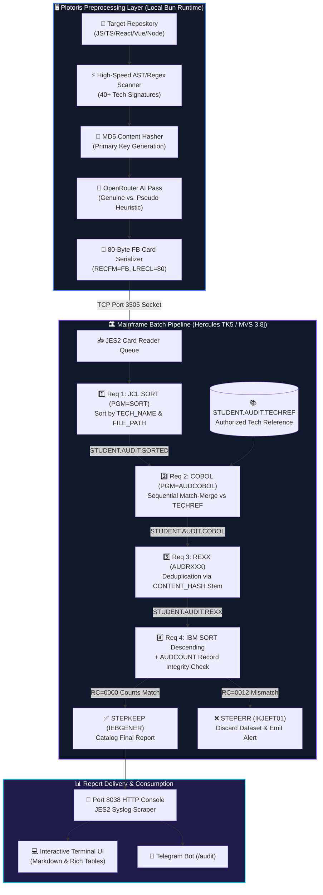

<div align="center">

# ⚡ MAINFRAME CODEBASE AUDITOR ⚡
### *Next-Gen Enterprise Codebase Authenticity & Dependency Verification Engine*

<p align="center">
  
</p>

[](file:///d:/Projects_Extended/Mainframe-Mega-Project/Documentation/MAINFRAME_AUDITOR_USER_MANUAL.md)
[-00599C?style=for-the-badge&logo=serverfault&logoColor=white)](file:///d:/Projects_Extended/Mainframe-Mega-Project/Documentation/HERCULES_PORTS_GUIDE.md)
[](file:///d:/Projects_Extended/Mainframe-Mega-Project/Mainframe-Programs/AUDCOBOL.cbl)
[](file:///d:/Projects_Extended/Mainframe-Mega-Project/Mainframe-Programs/AUDRXXX.rexx)
[](https://bun.sh)
[](https://www.typescriptlang.org)

<br/>

```text
 ╔═════════════════════════════════════════════════════════════════════════════════════╗
 ║   [01] LOCAL AST SCAN  ──>  [02] AI AUTHENTICITY  ──>  [03] 80-BYTE FLAT FILE (FB)  ║
 ║                                      │                                              ║
 ║                                      ▼                                              ║
 ║   [06] REPORT RETRIEVAL <── [05] TK5 JES2 MVS BATCH <── [04] TCP PORT 3505 SOCKET   ║
 ╚═════════════════════════════════════════════════════════════════════════════════════╝
```

---

</div>

## 🌌 Overview

The **Mainframe Codebase Auditor** is a hybrid enterprise system coupling modern agentic developer tooling with enterprise mainframe batch architecture. 

In academic and enterprise evaluations, developers often inject heavy libraries into `package.json` or write superficial `import` statements to mimic full-stack sophistication. This project inspects any target codebase, serializes AST and dependency metadata into strict **80-byte fixed-width (FB) card-image records**, streams them into an **IBM MVS 3.8j / Hercules TK5** mainframe emulator, and executes a 4-stage batch pipeline using **JCL, COBOL, and REXX** for their authentic architectural strengths.

> **Zero-Decorations Guarantee**: JCL condition codes, COBOL two-file sequential match-merge, and REXX stem hash-tables are executed for real system integrity verification—not ornamental wrappers.

---

## 🏛️ System Architecture



---

## 🎯 The Four Mandatory Course Requirements

| Requirement | Mainframe Tech | Implementation File | Architectural Role & Genuine Strength |
| :---: | :---: | :---: | :--- |
| **Requirement 1** | **JCL SORT** | [`STEP1_SORT.jcl`](file:///d:/Projects_Extended/Mainframe-Mega-Project/Mainframe-Programs/STEP1_SORT.jcl) | Sorts raw flat-file records by `TECH_NAME` (cols 41–50) and `FILE_PATH` (cols 1–40) to prepare aligned input streams for sequential matching. |
| **Requirement 2** | **COBOL Match-Merge** | [`AUDCOBOL.cbl`](file:///d:/Projects_Extended/Mainframe-Mega-Project/Mainframe-Programs/AUDCOBOL.cbl) | Reads two sequential files (`AUDREC` and reference table `TECHREF`), executes match-merge logic, maps canonical tech categories, and records audit metrics. |
| **Requirement 3** | **REXX Deduplication** | [`AUDRXXX.rexx`](file:///d:/Projects_Extended/Mainframe-Mega-Project/Mainframe-Programs/AUDRXXX.rexx) | Utilizes associative stems (`seen_hash.hash`) on the 8-character `CONTENT_HASH` primary key to isolate and prune duplicate source files, followed by primary-key sort. |
| **Requirement 4** | **IBM SORT Descending & Integrity Check** | [`STEP4_INTEGRITY_SUCCESS.jcl`](file:///d:/Projects_Extended/Mainframe-Mega-Project/Mainframe-Programs/STEP4_INTEGRITY_SUCCESS.jcl)<br/>[`STEP4_INTEGRITY_FAILURE.jcl`](file:///d:/Projects_Extended/Mainframe-Mega-Project/Mainframe-Programs/STEP4_INTEGRITY_FAILURE.jcl) | Copies and sorts records in descending order (`SORT FIELDS=(1,80,CH,D)`), verifies pre/post record counts via `AUDCOUNT.rexx`, and branches using JCL conditional execution (`COND=(0,NE)` keeps dataset, `COND=(0,EQ)` aborts and warns). **Tests both success & failure cases**. |

---

## 📜 80-Byte Fixed-Width Record Layout (RECFM=FB, LRECL=80)

Every record transmitted to MVS complies with standard 80-column punched card specifications:

```
  1                                     41        51       59        69  73      80
  ├──────────────────────────────────────┼─────────┼────────┼─────────┼───┼───────┤
  │              FILE_PATH               │TECH_NAME│  HASH  │USAGE_TYP│CNT│RESRVD │
  ├──────────────────────────────────────┼─────────┼────────┼─────────┼───┼───────┤
  │ SRC/COMPONENTS/USERPROFILE.TSX       │ REACT   │B9560F26│GENUINE  │002│       │
  │ SRC/LEGACY/FAKE-STORE.TS             │ REDUX   │E559B9A2│PSEUDO   │001│       │
  └──────────────────────────────────────┴─────────┴────────┴─────────┴───┴───────┘
```

---

## 🚀 Quick Start & Usage

### 1. Prerequisites
- **Runtime**: [Bun](https://bun.sh) (v1.1 or higher)
- **Mainframe**: Hercules TK5 (MVS 3.8j) — *Optional (Simulated fallback active when offline)*

### 2. Setup
```bash
# Clone the repository
git clone https://github.com/Sarthak-Jadhav-Dev/mainframe_code_analyzer.git
cd mainframe_code_analyzer/CLI-Tool

# Install dependencies
bun install
```

### 3. Launching the Interactive Auditor
```bash
bun run index.ts wakeup
```
1. Select **`🖥️ Mainframe`** from the interactive menu.
2. Provide the path to the target repository (e.g. `../demo-student-repo`).
3. Select your **Requirement 4 Test Mode**:
   - `Normal Verification (Success Case)`: Verifies zero records dropped and catalogs dataset.
   - `Simulate Failure Case`: Simulates dropped record, triggering Condition Code `0012` and automatic dataset discard.

---

## 🧪 Built-In Test Repository (`demo-student-repo`)

A dedicated student portfolio demo is provided at [`demo-student-repo/`](file:///d:/Projects_Extended/Mainframe-Mega-Project/demo-student-repo):

```text
demo-student-repo/
├── package.json
└── src/
    ├── components/
    │   └── UserProfile.tsx      <-- GENUINE React & Axios active usage
    ├── server.ts                <-- GENUINE Express backend API
    ├── db/
    │   └── client.ts            <-- GENUINE Prisma client
    ├── legacy/
    │   └── fake-store.ts        <-- PSEUDO / Superficial unused imports
    ├── utils/
    │   └── math-helper.ts       <-- Original file (Hash: 6691298E)
    └── helpers/
        └── calc-copy.ts         <-- EXACT DUPLICATE (Hash: 6691298E)
```

---

## 📡 Hercules Port Configuration

| Port | Service | Protocol | Function |
| :---: | :---: | :---: | :--- |
| **`3505`** | **Card Reader** | TCP Socket | Raw JCL submission directly into the JES2 reader queue |
| **`8038`** | **HTTP Console** | HTTP GET/POST | Syslog querying, condition code monitoring (`$HASP395`), and job output retrieval |
| **`3270`** | **TN3270 Terminal** | Telnet | Interactive operator console and TSO/E terminal |

---

## 📁 Repository Structure

```text
mainframe_code_analyzer/
├── CLI-Tool/                     # Plotoris agentic CLI (Bun + TypeScript)
│   ├── modes/mainframe/          # Mainframe orchestration, scanner & JCL engines
│   │   ├── flat-file-writer.ts   # 80-byte card serializer/deserializer
│   │   ├── hercules-client.ts    # TCP port 3505 & HTTP port 8038 driver
│   │   ├── jcl-templates.ts      # Multi-stage JCL template generator
│   │   ├── orcharstrator.ts      # 11-step interactive auditor pipeline
│   │   ├── scanner.ts            # Fast AST & regex tech detector (40+ libs)
│   │   └── types.ts              # Core data interfaces
│   └── modes/telegram/           # Telegram bot integration (/audit)
├── Mainframe-Programs/           # Pure MVS 3.8j assets (JCL, COBOL, REXX)
│   ├── AUDCOBOL.cbl              # COBOL 74/85 two-file match-merge program
│   ├── AUDRXXX.rexx              # TSO/E REXX deduplicator & primary key sorter
│   ├── AUDCOUNT.rexx             # REXX record count integrity comparator
│   ├── TECHREF.txt               # 80-byte reference table of authorized tech
│   ├── STEP1_SORT.jcl            # Requirement 1 JCL Sort
│   ├── STEP2_COBOL.jcl           # Requirement 2 COBOL Match-Merge JCL
│   ├── STEP3_REXX.jcl            # Requirement 3 REXX Deduplication JCL
│   ├── STEP4_INTEGRITY_SUCCESS.jcl # Requirement 4 Success Verification JCL
│   ├── STEP4_INTEGRITY_FAILURE.jcl # Requirement 4 Failure Test Case JCL
│   ├── PIPELINE_COMPLETE.jcl     # All-in-one multi-step JCL stream
│   └── INSTALL_TK5.jcl           # MVS library allocation & compilation JCL
├── Documentation/                # Verified system manuals & technical guides
│   ├── HERCULES_PORTS_GUIDE.md   # Port layout & verification notes
│   ├── HERCULES_INTEGRATION_GUIDE.md # Socket & HTTP API specifications
│   └── MAINFRAME_AUDITOR_USER_MANUAL.md # Step-by-step teacher demo manual
└── demo-student-repo/            # Evaluation test repo with genuine/pseudo code
```

---

<div align="center">

Developed with ❤️ for Advanced Enterprise Batch Systems Architecture.  
*Emulating 1970s Mainframe Power with 2026 Developer Agility.*

</div>
