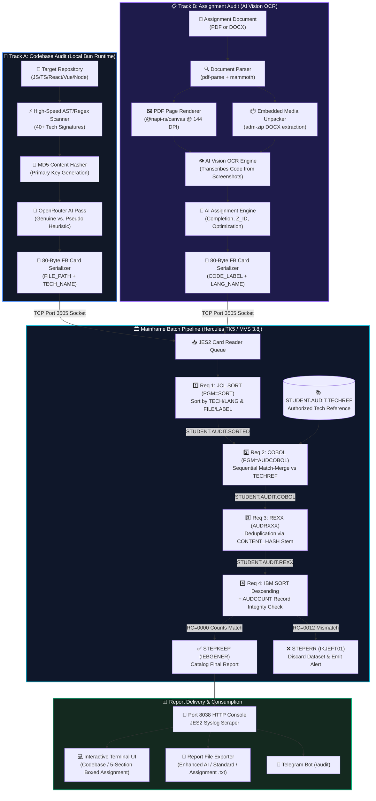

<div align="center">

# ⚡ MAINFRAME CODEBASE AUDITOR ⚡
### *Next-Gen Enterprise Codebase Authenticity & Dependency Verification Engine*

<p align="center">
  
</p>

[](file:///d:/Projects_Extended/Mainframe-Mega-Project/Documentation/MAINFRAME_AUDITOR_USER_MANUAL.md)
[-00599C?style=for-the-badge&logo=serverfault&logoColor=white)](file:///d:/Projects_Extended/Mainframe-Mega-Project/Documentation/HERCULES_PORTS_GUIDE.md)
[](file:///d:/Projects_Extended/Mainframe-Mega-Project/Mainframe-Programs/AUDCOBOL.cbl)
[](file:///d:/Projects_Extended/Mainframe-Mega-Project/Mainframe-Programs/AUDRXXX.rexx)
[](file:///d:/Projects_Extended/Mainframe-Mega-Project/Documentation/assignment_mode_plan.md)
[](file:///d:/Projects_Extended/Mainframe-Mega-Project/CLI-Tool/modes/mainframe/assignment/orchestrator.ts)
[](https://bun.sh)
[](https://www.typescriptlang.org)

<br/>

```text
 ╔═══════════════════════════════════════════════════════════════════════════════════════════════╗
 ║  [TRACK A] REPO AST SCAN       ──► AI AUTHENTICITY ──┐                                        ║
 ║  [TRACK B] PDF/DOCX + OCR SCAN ──► AI VISION OCR   ──┴──► [03] 80-BYTE FB CARD SERIALIZER     ║
 ║                                                                       │                       ║
 ║                                                                       ▼                       ║
 ║  [06] REPORT RETRIEVAL (5-SEC / ENHANCED) ◄── [05] TK5 MVS BATCH ◄── [04] TCP PORT 3505      ║
 ╚═══════════════════════════════════════════════════════════════════════════════════════════════╝
```

---

</div>

## 🌌 Overview

The **Mainframe Codebase Auditor** is a hybrid enterprise system coupling modern agentic developer tooling with enterprise mainframe batch architecture. It provides two operational auditing engines:

1. **📁 Track A: Codebase Audit**  
   Inspects any target repository, scans 40+ technology signatures via fast AST/regex analysis, validates genuine vs. pseudo framework usage with an AI pass, serializes metadata into strict **80-byte fixed-width (FB) card records**, and executes an authentic 4-stage **IBM MVS 3.8j / Hercules TK5** batch pipeline (**JCL SORT → COBOL Match-Merge → REXX Stem Deduplication → IBM SORT & Count Integrity**).

2. **📋 Track B: Student Assignment Audit**  
   Evaluates student assignment submissions submitted as **PDF** or **DOCX** documents. Solves the critical real-world problem where students embed screenshots of terminal outputs or IDEs rather than selectable text. By rendering PDF pages to high-res images via `@napi-rs/canvas` and unpacking embedded media via `adm-zip`, it passes images to an **AI Vision OCR** model to extract code, runs student **Z_ID consistency checks** across pages, grades code optimization & smells against the instructor's problem statement, formats code blocks into 80-byte FB records for TK5 verification, and compiles a comprehensive **5-Section Boxed Audit Report**.

> **Zero-Decorations Guarantee**: JCL condition codes, COBOL two-file sequential match-merge, and REXX stem hash-tables are executed for real system integrity verification—not ornamental wrappers.

---

## 🏛️ System Architecture



---

## 🎯 The Four Mandatory Course Requirements

| Requirement | Mainframe Tech | Implementation File | Architectural Role & Genuine Strength |
| :---: | :---: | :---: | :--- |
| **Requirement 1** | **JCL SORT** | [`STEP1_SORT.jcl`](file:///d:/Projects_Extended/Mainframe-Mega-Project/Mainframe-Programs/STEP1_SORT.jcl) | Sorts raw flat-file records by `TECH_NAME` (cols 41–50) and `FILE_PATH` (cols 1–40) to prepare aligned input streams for sequential matching. |
| **Requirement 2** | **COBOL Match-Merge** | [`AUDCOBOL.cbl`](file:///d:/Projects_Extended/Mainframe-Mega-Project/Mainframe-Programs/AUDCOBOL.cbl) | Reads two sequential files (`AUDREC` and reference table `TECHREF`), executes match-merge logic, maps canonical tech categories, and records audit metrics. |
| **Requirement 3** | **REXX Deduplication** | [`AUDRXXX.rexx`](file:///d:/Projects_Extended/Mainframe-Mega-Project/Mainframe-Programs/AUDRXXX.rexx) | Utilizes associative stems (`seen_hash.hash`) on the 8-character `CONTENT_HASH` primary key to isolate and prune duplicate source files, followed by primary-key sort. |
| **Requirement 4** | **IBM SORT Descending & Integrity Check** | [`STEP4_INTEGRITY_SUCCESS.jcl`](file:///d:/Projects_Extended/Mainframe-Mega-Project/Mainframe-Programs/STEP4_INTEGRITY_SUCCESS.jcl)<br/>[`STEP4_INTEGRITY_FAILURE.jcl`](file:///d:/Projects_Extended/Mainframe-Mega-Project/Mainframe-Programs/STEP4_INTEGRITY_FAILURE.jcl) | Copies and sorts records in descending order (`SORT FIELDS=(1,80,CH,D)`), verifies pre/post record counts via `AUDCOUNT.rexx`, and branches using JCL conditional execution (`COND=(0,NE)` keeps dataset, `COND=(0,EQ)` aborts and warns). **Tests both success & failure cases**. |

---

## 📜 80-Byte Fixed-Width Record Layouts (RECFM=FB, LRECL=80)

Every record transmitted to MVS complies with standard 80-column punched card specifications across both audit tracks:

### Track A: Codebase Audit Record Layout
```text
  1                                     41        51       59        69  73      80
  ├──────────────────────────────────────┼─────────┼────────┼─────────┼───┼───────┤
  │              FILE_PATH               │TECH_NAME│  HASH  │USAGE_TYP│CNT│RESRVD │
  ├──────────────────────────────────────┼─────────┼────────┼─────────┼───┼───────┤
  │ SRC/COMPONENTS/USERPROFILE.TSX       │ REACT   │B9560F26│GENUINE  │002│       │
  │ SRC/LEGACY/FAKE-STORE.TS             │ REDUX   │E559B9A2│PSEUDO   │001│       │
  └──────────────────────────────────────┴─────────┴────────┴─────────┴───┴───────┘
```

### Track B: Assignment Audit Record Layout
```text
  1                                     41        51       59        69  73      80
  ├──────────────────────────────────────┼─────────┼────────┼─────────┼───┼───────┤
  │              CODE_LABEL              │LANG_NAME│  HASH  │BLOCK_TYP│CNT│RESRVD │
  ├──────────────────────────────────────┼─────────┼────────┼─────────┼───┼───────┤
  │ BLOCK_001_PYTHON                     │ PYTHON  │A7F3901B│OCR      │042│       │
  │ BLOCK_002_COBOL                      │ COBOL   │32C8E190│TEXT     │085│       │
  └──────────────────────────────────────┴─────────┴────────┴─────────┴───┴───────┘
```
- **Cols 1–40 (`CODE_LABEL`)**: Block identifier (e.g. `BLOCK_001_PYTHON`)
- **Cols 41–50 (`LANG_NAME`)**: Detected language matched against authorized `TECHREF` table
- **Cols 51–58 (`HASH`)**: 8-character MD5 checksum for duplicate block detection in REXX
- **Cols 59–68 (`BLOCK_TYP`)**: Extraction provenance (`TEXT`, `OCR`, or `UNKNOWN`)
- **Cols 69–72 (`CNT`)**: Total source line count (zero-padded 4 digits)
- **Cols 73–80 (`RESRVD`)**: Reserved spacing ensuring strict 80-byte alignment

---

## 📋 Student Assignment Audit Mode (PDF / DOCX + Vision AI)

The **Student Assignment Audit** is a specialized hybrid evaluation engine designed for educators, teaching assistants, and automated grading pipelines to thoroughly audit student assignments submitted as **PDF** or **Word (DOCX)** documents.

### 💡 The Real-World Student Screenshot Problem
In programming and mainframe courses, students rarely submit clean text files. Instead, they capture **screenshots of terminal emulators (TN3270), IDEs, or batch outputs** and paste them into documents.
- Standard text extractors (`pdf-parse`, `pdftotext`) completely miss rasterized screenshot images, reporting "no code found".
- Plagiarism and integrity issues—such as students sharing screenshots from classmates with differing Student IDs (`Z_IDs`)—frequently evade manual grading.

### 🔬 The Dual-Engine Ingestion & OCR Pipeline
1. **High-Resolution Page Rendering**:
   - **PDFs**: Renders every page to a 144 DPI PNG buffer using `pdfjs-dist` and `@napi-rs/canvas`. Leveraging prebuilt native binaries, this runs seamlessly on Windows with **zero C++ compiler or Visual Studio dependencies**.
   - **DOCXs**: Extracts structured body text via `mammoth` and unpacks all embedded raster images (`word/media/*`) using `adm-zip`.
2. **AI Vision OCR & Language Classification**:
   - Dispatches page images and embedded screenshots to an AI vision model (OpenRouter) to transcribe source code from terminal windows and IDE screenshots.
   - Detects and categorizes code blocks across languages (`COBOL`, `JCL`, `REXX`, `Python`, `Java`, `C/C++`, `JavaScript`, `TypeScript`, `SQL`).
3. **Z_ID Multi-Page Consistency Verification**:
   - Automatically scans all pages and document headers for student identification numbers matching the z-ID format (`\bZ[\s-]?[0-9]{7,10}\b`).
   - Flags discrepancies where multiple student IDs appear across different pages—instantly catching spliced or borrowed assignment pages.
4. **AI Problem Alignment & Pedagogical Evaluation**:
   - Evaluates extracted code against the instructor's **Problem Statement**.
   - Calculates problem statement match percentage and checks requirements coverage.
   - Analyzes algorithmic time and space complexity, detects code smells, and assigns an overall optimization grade (A+ to F).
   - Generates actionable, pedagogical suggestions for student improvement.
5. **Mainframe Batch Pipeline Verification (TK5)**:
   - Serializes the extracted code blocks into 80-byte FB card records (`CODE_LABEL`, `LANG_NAME`, `HASH`, `BLOCK_TYP`, `LINE_COUNT`).
   - Streams the records through the Hercules TK5 batch pipeline:
     - **Stage 1 (SORT)**: Sorts extracted code blocks by programming language.
     - **Stage 2 (COBOL)**: Validates detected languages against the authorized `TECHREF` reference dataset.
     - **Stage 3 (REXX)**: Uses associative stem hashing to detect duplicate code blocks across submissions.
     - **Stage 4 (Integrity)**: Verifies that zero records were lost or corrupted during batch processing.

### 📊 5-Section Boxed Audit Report
The evaluation output is displayed in a structured terminal box and can be exported directly as a `.txt` file:

```text
════════════════════════════════════════════════════════════════════════
  MAINFRAME ASSIGNMENT AUDITOR — ASSIGNMENT EVALUATION REPORT
════════════════════════════════════════════════════════════════════════
  ┌──────────────────────────────────────────────────────────────────┐
  │ SECTION 1: ASSIGNMENT COMPLETION STATUS                          │
  ├──────────────────────────────────────────────────────────────────┤
  │ Verdict             : ✓ COMPLETED                                │
  │ Problem Match       : 92%                                        │
  │ Requirements Met    : 4 / 4                                      │
  └──────────────────────────────────────────────────────────────────┘
  ┌──────────────────────────────────────────────────────────────────┐
  │ SECTION 2: Z_ID CONSISTENCY CHECK                                │
  ├──────────────────────────────────────────────────────────────────┤
  │ Z_IDs Found         : Z12345678                                  │
  │ Consistency         : ✓ CONSISTENT                               │
  │ Details             : Single student ID detected across all page │
  └──────────────────────────────────────────────────────────────────┘
  ┌──────────────────────────────────────────────────────────────────┐
  │ SECTION 3: CODE OPTIMIZATION ANALYSIS                            │
  ├──────────────────────────────────────────────────────────────────┤
  │ Overall Grade       : A-                                         │
  │ Code Blocks Analyzed: 2                                          │
  │   [Block 1] COBOL                                                │
  │     Grade           : A                                          │
  │     Time Complexity : O(n)                                       │
  │     Space Complexity: O(1)                                       │
  │     Code Smells     : None                                       │
  └──────────────────────────────────────────────────────────────────┘
  ┌──────────────────────────────────────────────────────────────────┐
  │ SECTION 4: SUGGESTIONS FOR IMPROVEMENT                           │
  ├──────────────────────────────────────────────────────────────────┤
  │ 1. [COBOL] Add EVALUATE statement for cleaner status branching.  │
  │ 2. [ERROR HANDLING] Add explicit ON SIZE ERROR to COMPUTE verbs. │
  └──────────────────────────────────────────────────────────────────┘
  ┌──────────────────────────────────────────────────────────────────┐
  │ SECTION 5: MAINFRAME PIPELINE VERIFICATION (TK5)                 │
  ├──────────────────────────────────────────────────────────────────┤
  │ [STAGE 1] JCL SORT (by LANG_NAME)     : RC=0000 PASS             │
  │ [STAGE 2] COBOL Match-Merge           : RC=0000 PASS             │
  │ [STAGE 3] REXX Deduplication          : RC=0000 PASS             │
  │ [STAGE 4] Integrity Check             : RC=0000 PASS             │
  └──────────────────────────────────────────────────────────────────┘
════════════════════════════════════════════════════════════════════════
```

---

## 🚀 Quick Start & Usage

### 1. Prerequisites
- **Runtime**: [Bun](https://bun.sh) (v1.1 or higher)
- **AI Gateway**: OpenRouter API key configured in `.env` (`api_Key` or `OPENROUTER_API_KEY`)
- **PDF Page Renderer**: `@napi-rs/canvas` prebuilt binary (automatically installed via `bun install`, no C++ build tools required)
- **Mainframe**: Hercules TK5 (MVS 3.8j) — *Optional (Simulated fallback active when offline)*

### 2. Setup
```bash
# Clone the repository
git clone https://github.com/Sarthak-Jadhav-Dev/mainframe_code_analyzer.git
cd mainframe_code_analyzer/CLI-Tool

# Install dependencies (including @napi-rs/canvas, pdf-parse, mammoth, adm-zip)
bun install

# Configure API Key
cp .env.example .env
# Edit .env and set: api_Key=your_openrouter_api_key
```

### 3. Launching the Interactive Auditor
```bash
bun run index.ts wakeup
```
1. Select **`🖥️ Mainframe`** from the top-level mode selector.
2. Choose your **Mainframe Audit Sub-Mode**:

```text
? Select Mainframe Mode:
  ❯ 🖥️ Codebase Audit   - Scan a code repository via TK5 pipeline
    📋 Assignment Audit - Evaluate a PDF/DOCX student submission
```

#### Option A: Running a Codebase Audit
1. Select **`🖥️ Codebase Audit`**.
2. Provide the repository path (e.g. `../demo-student-repo`).
3. Select audit scope (Entire Project or AI-recommended sub-folder).
4. Select your **Requirement 4 Test Mode**:
   - `Normal Verification (Success Case)`: Verifies zero records dropped and catalogs dataset.
   - `Simulate Failure Case`: Simulates dropped record, triggering Condition Code `0012` and automatic dataset discard.
5. Review the terminal output and choose to export an **Enhanced AI Executive Report** or **Normal Report** to `.txt`.

#### Option B: Running an Assignment Audit
1. Select **`📋 Assignment Audit`**.
2. Enter the path to the student assignment (e.g. `./submissions/Assignment1.pdf` or `./submissions/Assignment1.docx`).
3. Enter the assignment's **Problem Statement** (e.g. *"Implement a sequential match-merge program in COBOL to reconcile account transactions"*).
4. The system automatically:
   - Renders each page and extracts text & embedded screenshot images.
   - Runs AI Vision OCR to extract code blocks and classify languages.
   - Performs student Z-ID consistency checks across all pages.
   - Evaluates code against requirements, checks optimization, and generates pedagogical suggestions.
   - Serializes code blocks to 80-byte FB card records and runs them through the TK5 batch pipeline.
5. Review the comprehensive **5-Section Boxed Report** and save it directly to a `.txt` file.

---

## 🧪 Built-In Test Repository (`demo-student-repo`)

A dedicated student portfolio demo is provided at [`demo-student-repo/`](file:///d:/Projects_Extended/Mainframe-Mega-Project/demo-student-repo):

```text
demo-student-repo/
├── package.json
└── src/
    ├── components/
    │   └── UserProfile.tsx      <-- GENUINE React & Axios active usage
    ├── server.ts                <-- GENUINE Express backend API
    ├── db/
    │   └── client.ts            <-- GENUINE Prisma client
    ├── legacy/
    │   └── fake-store.ts        <-- PSEUDO / Superficial unused imports
    ├── utils/
    │   └── math-helper.ts       <-- Original file (Hash: 6691298E)
    └── helpers/
        └── calc-copy.ts         <-- EXACT DUPLICATE (Hash: 6691298E)
```

---

## 📡 Hercules Port Configuration

| Port | Service | Protocol | Function |
| :---: | :---: | :---: | :--- |
| **`3505`** | **Card Reader** | TCP Socket | Raw JCL submission directly into the JES2 reader queue |
| **`8038`** | **HTTP Console** | HTTP GET/POST | Syslog querying, condition code monitoring (`$HASP395`), and job output retrieval |
| **`3270`** | **TN3270 Terminal** | Telnet | Interactive operator console and TSO/E terminal |

---

## 📁 Repository Structure

```text
mainframe_code_analyzer/
├── CLI-Tool/                     # Plotoris agentic CLI (Bun + TypeScript)
│   ├── modes/mainframe/          # Mainframe orchestration, scanner & JCL engines
│   │   ├── assignment/           # 📋 Assignment Audit engine (PDF/DOCX/OCR)
│   │   │   ├── assignment-analyzer.ts # AI analysis (completion, Z_ID, optimization)
│   │   │   ├── code-extractor.ts # AI Vision OCR from screenshots/images
│   │   │   ├── document-parser.ts # PDF (canvas render) + DOCX parser
│   │   │   ├── orchestrator.ts    # Assignment mode pipeline orchestrator
│   │   │   ├── report-builder.ts  # 5-section boxed report builder & file export
│   │   │   └── types.ts           # Type definitions & data interfaces
│   │   ├── flat-file-writer.ts   # 80-byte card serializer/deserializer
│   │   ├── hercules-client.ts    # TCP port 3505 & HTTP port 8038 driver
│   │   ├── jcl-templates.ts      # Multi-stage JCL template generator
│   │   ├── orcharstrator.ts      # Mainframe audit orchestrator & sub-mode router
│   │   ├── partitioner.ts        # AI-powered scope & partition selector
│   │   ├── scanner.ts            # Fast AST & regex tech detector (40+ libs)
│   │   └── types.ts              # Core data interfaces
│   └── modes/telegram/           # Telegram bot integration (/audit)
├── Mainframe-Programs/           # Pure MVS 3.8j assets (JCL, COBOL, REXX)
│   ├── AUDCOBOL.cbl              # COBOL 74/85 two-file match-merge program
│   ├── AUDRXXX.rexx              # TSO/E REXX deduplicator & primary key sorter
│   ├── AUDCOUNT.rexx             # REXX record count integrity comparator
│   ├── TECHREF.txt               # 80-byte reference table of authorized tech
│   ├── STEP1_SORT.jcl            # Requirement 1 JCL Sort
│   ├── STEP2_COBOL.jcl           # Requirement 2 COBOL Match-Merge JCL
│   ├── STEP3_REXX.jcl            # Requirement 3 REXX Deduplication JCL
│   ├── STEP4_INTEGRITY_SUCCESS.jcl # Requirement 4 Success Verification JCL
│   ├── STEP4_INTEGRITY_FAILURE.jcl # Requirement 4 Failure Test Case JCL
│   ├── PIPELINE_COMPLETE.jcl     # All-in-one multi-step JCL stream
│   └── INSTALL_TK5.jcl           # MVS library allocation & compilation JCL
├── Documentation/                # Verified system manuals & technical guides
│   ├── assignment_mode_plan.md   # Architectural specification for Assignment Mode
│   ├── HERCULES_PORTS_GUIDE.md   # Port layout & verification notes
│   ├── HERCULES_INTEGRATION_GUIDE.md # Socket & HTTP API specifications
│   └── MAINFRAME_AUDITOR_USER_MANUAL.md # Step-by-step teacher demo manual
└── demo-student-repo/            # Evaluation test repo with genuine/pseudo code
```

---

<div align="center">

Developed with ❤️ for Advanced Enterprise Batch Systems Architecture.  
*Emulating 1970s Mainframe Power with 2026 Developer Agility.*

</div>
